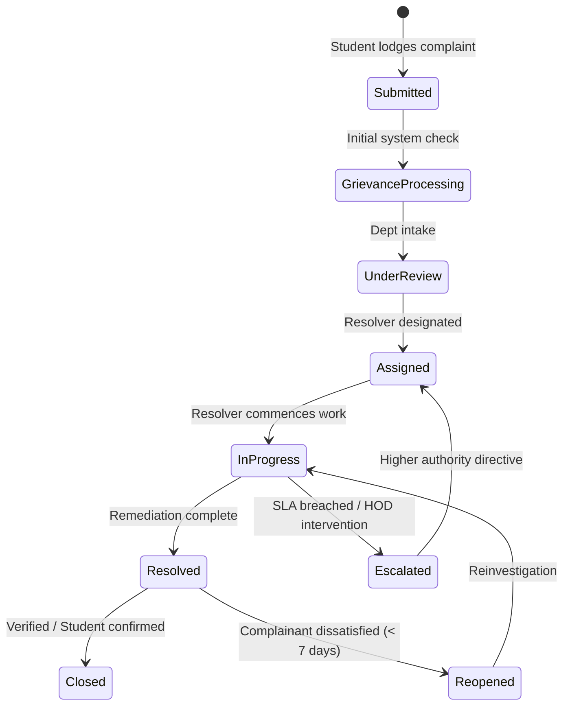

# Complaint & Grievance Management System (CGMS)

An institutional, enterprise-grade full-stack desktop application built for university and college grievance redressal cells. The system implements end-to-end complaint tracking, multi-role governance workflows, transparent lifecycle audit histories, SLA violation escalation mechanics, and analytical performance reporting.

---

## 🏛️ Application Roles & Access Control

The platform implements five distinct institutional roles with strict authorization enforcement at both the frontend (Protected Redux Routes) and backend (JWT & Role Middleware):

| Role | Responsibility | Default Demo Credentials |
| :--- | :--- | :--- |
| **Student / Complainant** | Lodges complaints, tracks real-time progress, reviews remediation milestones, reopens unresolved disputes, and submits resolution ratings. | `student@college.edu` / `password123` |
| **Department Resolver** | Investigates allocated complaints, updates milestone progression, records technical remarks, and submits resolution summaries. | `resolver@college.edu` / `password123` |
| **HOD / Dept Authority** | Oversees departmental complaint queues, assigns and reassigns staff resolvers, tracks SLA adherence, and reviews escalations. | `hod@college.edu` / `password123` |
| **Administrator** | Central console oversight, cross-department routing, user role management, department & category SLA configuration. | `admin@college.edu` / `password123` |
| **Higher Authority (Dean/Principal)** | Executive oversight of institution-wide disputes, review of escalated cases, and mandated resolution directives. | `principal@college.edu` / `password123` |

---

## 🔄 Grievance Lifecycle State Machine

Complaints strictly follow the institutional progression path with immutable audit trails:



Every transition automatically captures:
- `previousStatus` & `newStatus`
- `updatedBy` (Admin, HOD, Resolver, or Student)
- `remarks` & technical remediation directives
- `timestamp`

---

## ⚡ Technology Stack

### Frontend
- **Framework:** React.js (Vite)
- **State Management:** Redux Toolkit (`@reduxjs/toolkit`, `react-redux`)
  - `authSlice` (Session, Role, Profile)
  - `grievanceSlice` (Complaints, Tracking, Feedback)
  - `userSlice` (Directory, Resolvers, Roles)
  - `departmentSlice` (Departments directory)
  - `categorySlice` (Categories & SLA limits)
  - `notificationSlice` (In-app alerts & badges)
  - `dashboardSlice` (KPIs & Reports)
- **Styling:** Tailwind CSS v4 (Desktop Institutional Portal layout)
- **Routing:** React Router DOM (v7)
- **Visualizations:** Recharts (Interactive Area, Bar, and Pie Charts)
- **Icons:** Lucide React
- **HTTP Client:** Axios with centralized interceptors (`src/services/api.js`)
- **Notifications:** React-Toastify

### Backend
- **Runtime:** Node.js & Express.js (ES Modules)
- **Architecture:** MVC Architecture (Controllers, Models, Routes, Middleware, Utils)
- **Authentication:** JSON Web Tokens (JWT) & bcrypt.js password hashing
- **Security:** Role-based Authorization Middleware (`verifyJWT`, `authorizeRoles`), HTTP-only cookies, CORS protection
- **Database:** MongoDB with Mongoose ODM

---

## 📁 Project Directory Structure

```text
CGMS/
├── backend/
│   ├── src/
│   │   ├── config/
│   │   │   └── db.js                 # MongoDB connection logic
│   │   ├── controllers/
│   │   │   ├── auth.controller.js
│   │   │   ├── user.controller.js
│   │   │   ├── department.controller.js
│   │   │   ├── category.controller.js
│   │   │   ├── grievance.controller.js
│   │   │   ├── notification.controller.js
│   │   │   └── dashboard.controller.js
│   │   ├── middlewares/
│   │   │   ├── auth.middleware.js     # verifyJWT & authorizeRoles
│   │   │   └── error.middleware.js    # Global error handler
│   │   ├── models/
│   │   │   ├── User.js
│   │   │   ├── Department.js
│   │   │   ├── Category.js
│   │   │   ├── Grievance.js
│   │   │   ├── Notification.js
│   │   │   └── Feedback.js
│   │   ├── routes/                    # Express REST endpoints
│   │   ├── utils/                     # ApiResponse, ApiError, asyncHandler
│   │   ├── seed.js                    # Database seeder (Demo accounts & complaints)
│   │   ├── app.js                     # Express app configuration
│   │   └── index.js                   # Server bootstrap
│   ├── .env
│   ├── .env.example
│   └── package.json
│
├── frontend/
│   ├── src/
│   │   ├── components/
│   │   │   ├── Navbar.jsx             # Top institutional header + Demo Role Switcher
│   │   │   ├── Sidebar.jsx            # Dark navy collapsible navigation
│   │   │   ├── StatCard.jsx
│   │   │   ├── DataTable.jsx          # Professional table with pagination
│   │   │   ├── StatusBadge.jsx        # Standardized lifecycle badges
│   │   │   ├── PriorityBadge.jsx      # Low, Medium, High, Urgent badges
│   │   │   ├── SearchBar.jsx
│   │   │   ├── FilterDropdown.jsx
│   │   │   ├── Modal.jsx
│   │   │   ├── FormInput.jsx
│   │   │   ├── LoadingSpinner.jsx
│   │   │   ├── EmptyState.jsx
│   │   │   ├── NotificationPanel.jsx  # Slide-out real-time notifications
│   │   │   └── ProtectedRoute.jsx     # Role-based route guards
│   │   ├── layouts/
│   │   │   └── MainLayout.jsx
│   │   ├── pages/
│   │   │   ├── Login.jsx              # 1-Click Demo Account Sign-in
│   │   │   ├── Register.jsx
│   │   │   ├── StudentDashboard.jsx
│   │   │   ├── ResolverDashboard.jsx
│   │   │   ├── HodDashboard.jsx
│   │   │   ├── HigherAuthorityDashboard.jsx
│   │   │   ├── AdminDashboard.jsx
│   │   │   ├── SubmitGrievance.jsx
│   │   │   ├── MyGrievances.jsx
│   │   │   ├── GrievanceDetails.jsx   # Stepper, audit trail & feedback
│   │   │   ├── ManageGrievances.jsx
│   │   │   ├── ManageUsers.jsx
│   │   │   ├── DepartmentsPage.jsx
│   │   │   ├── CategoriesPage.jsx
│   │   │   ├── NotificationsPage.jsx
│   │   │   ├── ReportsPage.jsx        # Live charts & CSV export
│   │   │   └── ProfileSettingsPage.jsx
│   │   ├── redux/
│   │   │   ├── store.js
│   │   │   └── slices/                # 7 Redux Toolkit slices
│   │   ├── services/
│   │   │   └── api.js                 # Centralized Axios service
│   │   ├── App.jsx
│   │   ├── main.jsx
│   │   └── index.css                  # Tailwind CSS import
│   ├── vite.config.js
│   ├── .env
│   └── package.json
│
├── .gitignore
└── package.json                       # Unified workspace scripts
```

---

## 🚀 Execution & Setup Instructions

### 1. Database Seeding (Pre-populates all 5 roles & initial complaints)
In a terminal window:
```bash
cd backend
npm run seed
```
*Creates initial departments, categories, 5 demo user accounts, and 4 sample complaints with audit trails.*

### 2. Start the Backend API Server
```bash
cd backend
npm run dev
```
*API server runs at `http://localhost:8000`. Health check at `http://localhost:8000/api/v1/health`.*

### 3. Start the Frontend Application
In a separate terminal window:
```bash
cd frontend
npm run dev
```
*Frontend runs at `http://localhost:5173`.*

---

## 🧪 Testing the Complete Institutional Workflow

1. Open `http://localhost:5173/login`.
2. Click any of the **One-Click Demo Account** buttons:
   - **Student:** `student@college.edu`
   - **Resolver:** `resolver@college.edu`
   - **HOD:** `hod@college.edu`
   - **Admin:** `admin@college.edu`
   - **Higher Authority:** `principal@college.edu`
   *(Password for all demo accounts is `password123`)*
3. **As a Student:**
   - Click **"Lodge New Complaint"** and submit a grievance. A unique tracking ID (e.g. `GRV-2026-0005-XXXX`) is automatically generated.
4. **As an Admin / HOD:**
   - Switch role using the top Navbar switcher or log in as Admin.
   - Go to **Manage Complaints**, find the new complaint, and click **Route** to assign it to a staff resolver.
5. **As a Resolver:**
   - Log in or switch to Resolver.
   - In the **Resolver Workspace**, see the assigned complaint, click **Update**, transition status to **In Progress** or **Resolved**, and record remediation remarks.
6. **As a Student:**
   - Review the **Milestone Progression Stepper**, inspect resolver remarks, and submit 1–5 star resolution feedback.
7. **As Higher Authority / Admin:**
   - Open **SLA & Audit Reports** to view interactive monthly trends, department performance charts, and click **Export CSV Audit** to download live institutional records.
